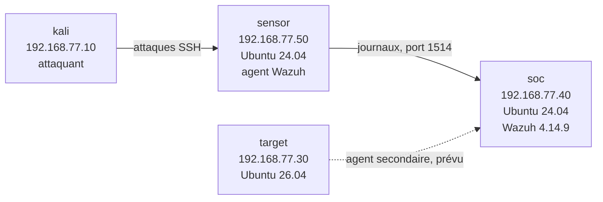

# wazuh-mini-soc

Laboratoire SOC virtualisé : supervision et détection d'attaques avec **Wazuh**, construit de zéro sur VirtualBox, avec attaques jouées depuis Kali Linux contre mes propres machines.

> **État : en cours.** Wazuh est installé, un premier agent (`sensor`) est enrôlé et actif. Les tests de détection et les mesures sont à venir. Ce document est mis à jour à chaque étape (voir le [journal de progression](#journal-de-progression)).

## Objectif

Boucler le cycle complet d'un SOC à petite échelle : **attaque, journal, détection, alerte, réponse**, puis mesurer ce que la détection capte réellement (taux de détection, faux positifs, temps de détection).

Ce dépôt est aussi un journal d'apprentissage : les difficultés rencontrées et leur résolution y sont documentées.

## Architecture



Réseau : Host-Only VirtualBox `192.168.77.0/24` pour le laboratoire, plus une carte NAT par VM pour les mises à jour.

| Rôle | Hostname | Système | Adresse | Ressources |
|---|---|---|---|---|
| SOC (Wazuh tout-en-un) | `soc` | Ubuntu 24.04.5 LTS | 192.168.77.40 | 4 vCPU, 8 Go de RAM, disque 25 Go |
| Capteur (agent Wazuh) | `sensor` | Ubuntu 24.04.5 LTS | 192.168.77.50 | 2 Go de RAM |
| Cible secondaire | `target` | Ubuntu 26.04.1 LTS | 192.168.77.30 | 2 Go de RAM, allumée ponctuellement |
| Poste d'attaque | `kali` | Kali Rolling 2026.3 | 192.168.77.10 | 2 Go de RAM, allumée pour les tests |

Hôte : PC Windows, Intel Core i7-1185G7, 16 Go de RAM. Détail dans [`architecture/inventaire.md`](architecture/inventaire.md).

## Avancement

- [x] Inventaire des machines et choix des rôles
- [x] Réseau Host-Only validé, accès Internet des VM validé
- [x] Wazuh 4.14.9 installé sur `soc`, tableau de bord accessible
- [x] Agent Wazuh installé sur `sensor`, état « active » dans le tableau de bord (capture ci-dessous)
- [ ] Vérifier la compatibilité de version : l'agent est en 4.14.10, le manager doit être en version égale ou supérieure
- [ ] Première détection : échecs SSH et force brute, depuis Kali
- [ ] Mesures : taux de détection, faux positifs, temps de détection
- [ ] Règles de détection personnalisées, mappées sur MITRE ATT&CK
- [ ] Agrandissement du disque de `soc` (25 Go, jugé juste à moyen terme)
- [ ] Suricata (IDS réseau) intégré à Wazuh
- [ ] Prototype de réponse automatisée en Python (blocage d'IP avec dry-run et retour arrière)
- [ ] Scénario Windows (Sysmon, Active Directory)

## Installation de Wazuh (reproduction)

Sur `soc`, avec **toutes les autres VM éteintes** (les ressources sont justes sur un hôte à 16 Go) :

```bash
sudo apt update && sudo apt upgrade -y
sudo apt install -y curl gnupg ca-certificates tmux
tmux new -s wazuh
curl -s -o wazuh-install.sh https://packages.wazuh.com/4.14/wazuh-install.sh
sudo bash ./wazuh-install.sh -a -v 2>&1 | tee ~/install-output.txt
```

Vérification :

```bash
sudo systemctl is-active wazuh-indexer wazuh-manager wazuh-dashboard filebeat   # quatre "active"
```

Tableau de bord : `https://192.168.77.40` (certificat auto-signé, avertissement normal). Le mot de passe `admin` est affiché à la fin de l'installation : il se conserve dans un gestionnaire de mots de passe, jamais dans ce dépôt.

Agent sur `sensor` :

```bash
sudo apt install -y gnupg apt-transport-https curl
curl -s https://packages.wazuh.com/key/GPG-KEY-WAZUH | sudo gpg --dearmor -o /usr/share/keyrings/wazuh.gpg
echo "deb [signed-by=/usr/share/keyrings/wazuh.gpg] https://packages.wazuh.com/4.x/apt/ stable main" | sudo tee /etc/apt/sources.list.d/wazuh.list
sudo apt update
sudo WAZUH_MANAGER="192.168.77.40" apt install -y wazuh-agent
sudo systemctl enable --now wazuh-agent
```

## Captures

### Tableau de bord Wazuh

Page de connexion, accessible sur `https://192.168.77.40` une fois l'installation terminée.


### Agent `sensor` enrôlé

L'agent `sensor` (ID 002, 192.168.77.50, Ubuntu 24.04.5 LTS, v4.14.10) apparaît à l'état « active » dans la liste des agents.


## Problèmes rencontrés

| Problème | Observation | Résolution |
|---|---|---|
| Deux installations de Wazuh échouées | Le journal `/var/log/wazuh-install.log` montre que `wazuh-manager` n'a pas démarré dans le délai (timeout), puis que l'installateur a désinstallé l'indexer et annulé l'installation. | Restauration d'un snapshot, passage à 4 vCPU (la VM en avait 2) et 8 Go de RAM, autres VM éteintes, installation dans `tmux` avec l'option `-v`. L'installation suivante a réussi. **La cause exacte n'a pas été isolée** : un démarrage trop lent faute de ressources est l'hypothèse la plus probable, non démontrée. |
| Le script s'affichait à l'écran au lieu d'être enregistré | Commande `curl -s0` (zéro) au lieu de `curl -sO` (lettre O). | Utiliser `curl -s -o wazuh-install.sh <url>`, qui évite la confusion. |
| `ping packages.wazuh.com` échoue | Le serveur ne répond pas aux pings. Ce n'était pas une panne réseau. | Tester par téléchargement : `curl -sI <url>` renvoie `HTTP/2 200`, et `ping 8.8.8.8` valide la route. |
| `services inactive` après restauration | `inactive` s'affiche aussi pour un service jamais installé. | Vérifier l'installation avec `dpkg -l \| grep -i wazuh` avant de conclure à un échec. |
| Windows n'atteint pas les VM en SSH | L'adaptateur Host-Only de Windows ne semble pas dans `192.168.77.0/24`. **Non résolu**, à investiguer avec `ipconfig`. | Contournement : les attaques sont jouées depuis Kali, qui est dans le bon réseau. |
| Noms d'interface différents selon les VM | Sur `target` (26.04), le Host-Only est `enp0s3` et le NAT `enp0s8` ; c'est l'inverse sur `soc`. | Toujours vérifier `ip -br addr` avant de modifier une configuration réseau. |

## Résultats

*À compléter après les tests d'attaque. Aucune valeur n'est présentée tant qu'elle n'a pas été mesurée.*

| Scénario | Essais | Détectés | Faux positifs | Temps de détection moyen |
|---|---|---|---|---|
| Échecs SSH, utilisateur inexistant | | | | |
| Échecs SSH, utilisateur existant | | | | |
| Force brute SSH (Kali, hydra) | | | | |

Protocole prévu : plusieurs essais par scénario, heure de l'attaque et heure de l'alerte relevées, résultats consignés dans [`reports/`](reports/).

## Sécurité et périmètre

- Toutes les attaques sont jouées **uniquement contre mes propres machines virtuelles**, dans un réseau isolé de mon PC.
- Avant les tests d'attaque, le dossier partagé de l'hôte monté dans Kali est retiré, ainsi que le presse-papiers partagé et le glisser-déposer.
- Un snapshot est pris avant chaque changement important.
- Aucun mot de passe, jeton ou journal contenant des données personnelles n'est publié dans ce dépôt.

## Structure du dépôt

```
wazuh-mini-soc/
├── README.md
├── architecture/
│   └── inventaire.md
├── installation/
│   └── setup-guide.md
├── screenshots/
└── reports/
```

## Journal de progression

| Date | Avancement |
|---|---|
| 2 nov. 2026 | Inventaire des quatre machines. Réseau Host-Only 192.168.77.0/24 et accès Internet validés. Première installation de Wazuh : échec (timeout du manager, annulation automatique). |
| 4 nov. 2026 | Deuxième installation : même échec. Passage à 4 vCPU et 8 Go de RAM. Installation suivante réussie : Wazuh 4.14.9 opérationnel. |
| 4 nov. 2026 | Agent Wazuh installé sur `sensor`, visible dans le tableau de bord. Test d'attaque depuis Windows impossible (réseau), reporté à Kali. |

| 9 nov. 2026 | Agent `sensor` confirmé « active » (192.168.77.50). Captures ajoutées. Point à vérifier : version de l'agent (4.14.10) par rapport à celle du manager. |

*Prochaine étape : première détection (échecs SSH depuis Kali) et relevé des temps de détection.*
