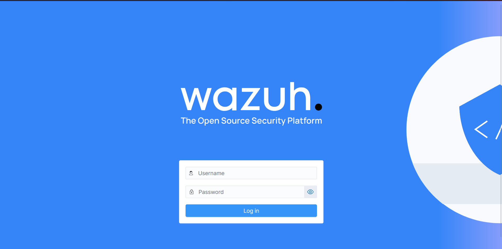
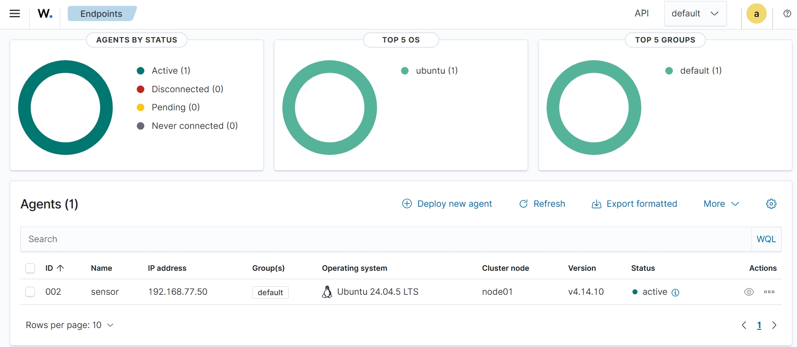
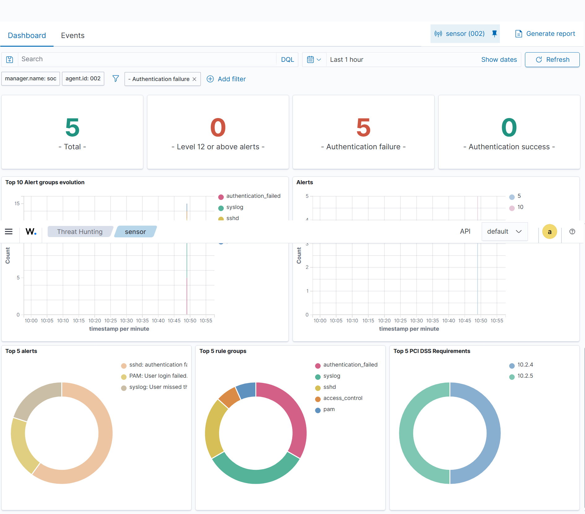
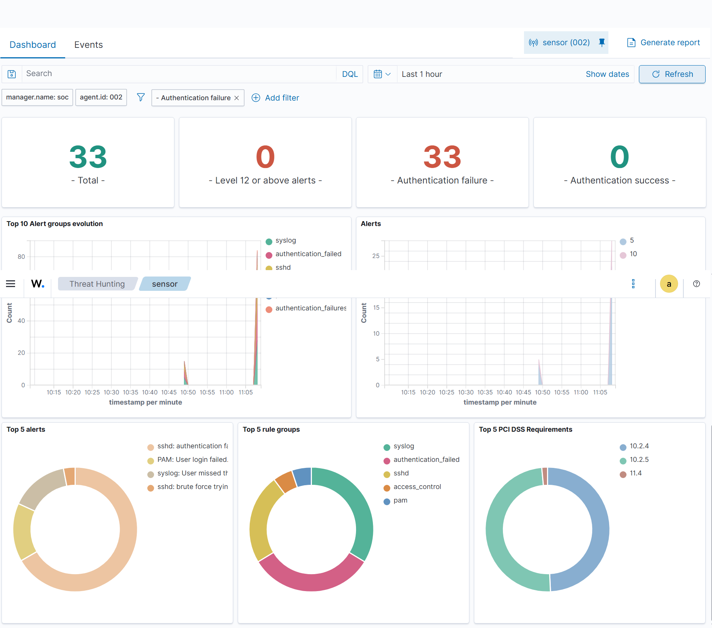

# wazuh-mini-soc

**Laboratoire SOC virtualisé : supervision, détection et analyse d'attaques avec Wazuh**


## Résumé

Ce projet reproduit à petite échelle le fonctionnement d'un centre des opérations de sécurité (SOC). Un serveur Wazuh centralise et analyse les journaux de machines supervisées ; des attaques jouées depuis Kali Linux contre mes propres machines servent à vérifier ce que la détection capte réellement.

L'objectif est de boucler le cycle **attaque, journal, détection, alerte, réponse**, puis de **mesurer** la qualité de la détection (taux de détection, faux positifs, temps de détection) plutôt que de se limiter à une démonstration.

**État actuel :** l'infrastructure est déployée et opérationnelle (Wazuh installé, agent enrôlé) et une **première détection a été obtenue** : des échecs d'authentification SSH joués depuis Kali ont généré des alertes dans Wazuh. Les campagnes de mesure et les règles personnalisées sont en cours.

## Compétences mises en œuvre

| Domaine | Réalisation dans ce projet |
|---|---|
| Virtualisation et réseau | Conception d'un laboratoire sous VirtualBox : réseau Host-Only `192.168.77.0/24` pour le trafic du laboratoire, NAT pour les mises à jour, adressage fixe, validation de la connectivité |
| Administration Linux | Dimensionnement des VM (vCPU, RAM, disque), gestion des services avec `systemd`, sessions `tmux`, lecture des journaux système |
| SIEM | Déploiement de Wazuh en tout-en-un (indexer, manager, dashboard, Filebeat), enrôlement d'un agent, supervision depuis le tableau de bord |
| Diagnostic | Analyse de deux échecs d'installation à partir des journaux (`wazuh-install.log`, `ossec.log`, `journalctl`), démarche par hypothèses et tests |
| Rigueur opérationnelle | Snapshots avant chaque changement, documentation des écarts et des erreurs, périmètre d'attaque strictement limité au laboratoire |
| Détection | Premières alertes obtenues à partir d'échecs d'authentification SSH joués depuis Kali ; lecture des alertes dans le tableau de bord (groupes de règles, exigences PCI DSS associées). En cours : mesures, règles personnalisées, cartographie MITRE ATT&CK |

## Architecture


| Rôle | Hostname | Système | Adresse | Ressources |
|---|---|---|---|---|
| Serveur SOC (Wazuh tout-en-un) | `soc` | Ubuntu 24.04.5 LTS | 192.168.77.40 | 4 vCPU, 8 Go de RAM, 25 Go de disque |
| Machine supervisée (agent) | `sensor` | Ubuntu 24.04.5 LTS | 192.168.77.50 | 2 Go de RAM |
| Cible secondaire | `target` | Ubuntu 26.04.1 LTS | 192.168.77.30 | 2 Go de RAM, allumée ponctuellement |
| Poste d'attaque | `kali` | Kali Linux Rolling 2026.3 | 192.168.77.10 | 2 Go de RAM |

Hôte : PC Windows, Intel Core i7-1185G7, 16 Go de RAM. Le détail est dans [`architecture/inventaire.md`](architecture/inventaire.md).

## Stack technique

| Composant | Rôle |
|---|---|
| Wazuh 4.14 (indexer, manager, dashboard, Filebeat) | SIEM : collecte, analyse, corrélation et visualisation des événements |
| Agent Wazuh | Remontée des journaux de la machine supervisée |
| Ubuntu Server 24.04 LTS | Système du serveur SOC et de la machine supervisée |
| Kali Linux | Génération d'attaques contre le laboratoire |
| VirtualBox | Virtualisation et réseau isolé |
| OpenSSH, tmux, systemd | Services, accès distant et exécution robuste |

## Captures

**Tableau de bord Wazuh**, accessible sur `https://192.168.77.40` :



**Agent `sensor` enrôlé** (ID 002, 192.168.77.50, Ubuntu 24.04.5 LTS) à l'état « active » :



**Détection d'échecs SSH** (essai manuel, 3 échecs) :



**Détection de force brute** (hydra, 20 essais, règle « brute force » déclenchée) :



## Déploiement

Sur `soc`, avec les autres VM éteintes (l'hôte est à 16 Go de RAM) :

```bash
sudo apt update && sudo apt upgrade -y
sudo apt install -y curl gnupg ca-certificates tmux
tmux new -s wazuh
curl -s -o wazuh-install.sh https://packages.wazuh.com/4.14/wazuh-install.sh
sudo bash ./wazuh-install.sh -a -v 2>&1 | tee ~/install-output.txt
sudo systemctl is-active wazuh-indexer wazuh-manager wazuh-dashboard filebeat
```

Le mot de passe `admin` généré est conservé dans un gestionnaire de mots de passe, jamais dans le dépôt.

Agent sur `sensor` :

```bash
sudo apt install -y gnupg apt-transport-https curl
curl -s https://packages.wazuh.com/key/GPG-KEY-WAZUH | sudo gpg --dearmor -o /usr/share/keyrings/wazuh.gpg
echo "deb [signed-by=/usr/share/keyrings/wazuh.gpg] https://packages.wazuh.com/4.x/apt/ stable main" | sudo tee /etc/apt/sources.list.d/wazuh.list
sudo apt update
sudo WAZUH_MANAGER="192.168.77.40" apt install -y wazuh-agent
sudo systemctl enable --now wazuh-agent
```

## Première détection

### Essai 1 : échecs manuels (compte existant)

Trois échecs d'authentification SSH vers `sensor`, depuis Kali (192.168.77.10), avec un compte existant (`ubuntu`) et un mauvais mot de passe.

| Étape | Observation |
|---|---|
| Trace sur `sensor` (`/var/log/auth.log`) | `authentication failure`, puis `Failed password for ubuntu from 192.168.77.10`, puis deux échecs répétés, de 10:49:27 à 10:49:43 (UTC). |
| Alertes dans Wazuh | 5 alertes d'échec d'authentification, 0 alerte de niveau 12 ou supérieur, 0 authentification réussie. |
| Types d'alertes | `sshd: authentication failed`, `PAM: User login failed`, un message `syslog` de mot de passe manqué. |

### Essai 2 : force brute automatisée (hydra)

Attaque par dictionnaire avec `hydra`, 20 mots de passe testés contre le compte `ubuntu`, 4 tentatives en parallèle :

```
hydra -l ubuntu -P /tmp/mots.txt -t 4 -f ssh://192.168.77.50
```

| Étape | Observation |
|---|---|
| Déroulement | Démarré à 06:08:02 UTC, terminé à 06:08:26 UTC (24 secondes), 20 identifiants testés, 0 mot de passe valide trouvé (attendu : le dictionnaire ne contient pas le vrai mot de passe) |
| Alertes dans Wazuh | **33 alertes** d'échec d'authentification sur `sensor` dans l'heure suivant l'essai, contre 5 pour le test manuel : le volume d'alertes suit le volume d'essais |
| Règle franchie | Une alerte **« sshd: brute force trying... »** apparaît dans le Top 5 des alertes, absente du premier essai : le passage de 3 à 20 échecs rapprochés a déclenché la règle de force brute |
| Nouveaux groupes et conformité | Apparition du groupe `access_control` en tête, et de l'exigence PCI DSS **11.4** (détection d'intrusion), en plus de 10.2.4 et 10.2.5 déjà vues |
| Niveau 12 ou plus | 0 — la règle de force brute s'est déclenchée à un niveau de gravité inférieur à 12, à confirmer avec le détail de l'alerte |

**Lecture** : le seuil de détection de force brute se situe entre 3 échecs (non détecté comme force brute) et 20 échecs en 24 secondes (détecté). Le `rule.id` exact et le niveau précis de l'alerte « brute force » restent à relever dans l'onglet Events, de même que l'heure exacte de l'alerte pour calculer le temps de détection.

## Retour d'expérience

| Problème | Analyse | Résolution |
|---|---|---|
| Deux installations de Wazuh échouées | Le journal d'installation montre que `wazuh-manager` n'a pas démarré dans le délai imparti (timeout), puis que l'installateur a tout annulé. | Retour à un snapshot sain, passage de 2 à 4 vCPU et à 8 Go de RAM, autres VM éteintes, installation dans `tmux` avec journalisation détaillée. Installation réussie ensuite. La cause exacte n'a pas été isolée ; un démarrage trop lent faute de ressources est l'hypothèse la plus probable. |
| `ping` vers le dépôt Wazuh sans réponse | Le serveur ne répond pas aux pings, ce n'est pas une panne réseau. | Validation par téléchargement (`curl -sI` renvoie `HTTP/2 200`) et par `ping 8.8.8.8`. |
| Services `inactive` après restauration d'un snapshot | `inactive` s'affiche aussi pour un service jamais installé. | Contrôle de l'installation avec `dpkg -l` avant de conclure à un échec. |
| « No results » dans le tableau de bord après l'attaque | La période sélectionnée était un seul instant (début égal à fin), donc vide par construction. | Réglage sur « Last 1 hour » : les alertes sont apparues. Une vue vide ne prouve pas l'absence de détection. |
| Fuseau horaire affiché différent de celui des journaux | Le tableau de bord affichait une heure locale, les journaux de `sensor` sont en UTC. | Comparer toujours deux heures dans le même fuseau avant de calculer un temps de détection. |
| Noms d'interface réseau différents selon les VM | Le Host-Only est `enp0s3` sur une VM et `enp0s8` sur une autre. | Vérification systématique avec `ip -br addr` avant toute modification réseau. |

## Avancement

- [x] Inventaire des machines, choix des rôles, plan d'adressage
- [x] Réseau Host-Only et accès Internet validés
- [x] Wazuh installé, tableau de bord accessible
- [x] Agent enrôlé sur `sensor`, état « active »
- [ ] Aligner les versions du manager et de l'agent
- [x] Première détection : échecs d'authentification SSH depuis Kali, alertes visibles dans Wazuh
- [x] Scénario de force brute (hydra, 20 essais) : règle « brute force » déclenchée
- [ ] Relevé précis des `rule.id`, niveaux et heures de chaque alerte (temps de détection)
- [ ] Mesure des faux positifs sur trafic légitime
- [ ] Mesures : taux de détection, faux positifs, temps de détection
- [ ] Règles de détection personnalisées, cartographiées sur MITRE ATT&CK
- [ ] Agrandissement du disque de `soc` (25 Go, juste à moyen terme)
- [ ] Intégration de Suricata (IDS réseau)
- [ ] Prototype de réponse automatisée en Python (blocage d'IP avec dry-run et retour arrière)
- [ ] Scénario Windows (Sysmon, Active Directory)

## Résultats

*Une seule ligne est renseignée à ce jour (un essai). Les autres sont à compléter après les campagnes d'attaque. Aucune valeur n'est publiée avant d'avoir été mesurée.*

| Scénario | Essais | Détectés | Faux positifs | Temps de détection moyen |
|---|---|---|---|---|
| Échecs SSH, utilisateur inexistant | | | | |
| Échecs SSH, utilisateur existant (manuel) | 1 essai, 3 échecs | Oui : 5 alertes d'échec d'authentification | Non mesurés | À relever |
| Force brute SSH (hydra, dictionnaire) | 1 essai, 20 échecs en 24 s | Oui : 33 alertes, dont la règle « brute force » | Non mesurés | À relever |
| Force brute SSH (hydra depuis Kali) | | | | |

Protocole : plusieurs essais par scénario, heure de l'attaque et heure de l'alerte relevées, résultats consignés dans [`reports/`](reports/).

## Sécurité et éthique

- Toutes les attaques visent **uniquement mes propres machines virtuelles**, dans un réseau isolé.
- Le dossier partagé de l'hôte, le presse-papiers partagé et le glisser-déposer sont désactivés sur Kali avant les tests.
- Un snapshot est pris avant chaque changement important.
- Aucun mot de passe, jeton ni donnée personnelle n'est publié dans ce dépôt.

## Structure du dépôt

```
wazuh-mini-soc/
├── README.md
├── architecture/
│   └── inventaire.md
├── installation/
│   └── setup-guide.md
├── screenshots/
│   ├── wazuh-login.png
│   ├── agent-sensor-active.jpeg
│   ├── detection-ssh-dashboard.png
│   └── detection-bruteforce-dashboard.png
└── reports/
```

## Auteur

**[Armand Judicaël KI]**, étudiant ingénieur en cybersécurité, École Polytechnique de Ouagadougou (EPO), Burkina Faso.
Objectif : opérations de sécurité (SOC) et conception de solutions de cybersécurité.

[www.linkedin.com/in/armand-ki-a43667346](www.linkedin.com/in/armand-ki-a43667346) · [kiarmand413@gmail.com](mailto:kiarmand413@gmail.com)

## Journal de progression

| Date | Avancement |
|---|---|
| 2 nov. 2026 | Inventaire des machines, réseau validé. Première installation de Wazuh : échec (timeout du manager, annulation automatique). |
| 4 nov. 2026 | Deuxième échec, puis ajustement des ressources (4 vCPU, 8 Go) et installation réussie. Agent installé sur `sensor`. |
| 9 nov. 2026 | Agent `sensor` confirmé « active ». Captures ajoutées au dépôt. |

| 9 nov. 2026 | Première attaque SSH depuis Kali contre `sensor` (3 échecs, compte existant) : traces dans `auth.log` et 5 alertes d'authentification dans Wazuh. |
| 9 nov. 2026 | Force brute automatisée avec hydra (20 essais en 24 s) : 33 alertes générées, règle « brute force » franchie pour la première fois. Nouvelle exigence PCI DSS 11.4 associée. |

*Prochaine étape : relevé précis des `rule.id`, niveaux et heures dans l'onglet Events pour calculer le temps de détection, mesure des faux positifs sur trafic légitime, puis règle de détection personnalisée.*
